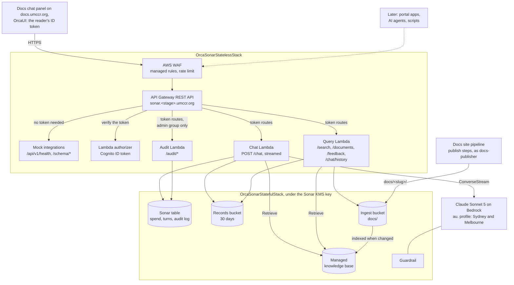
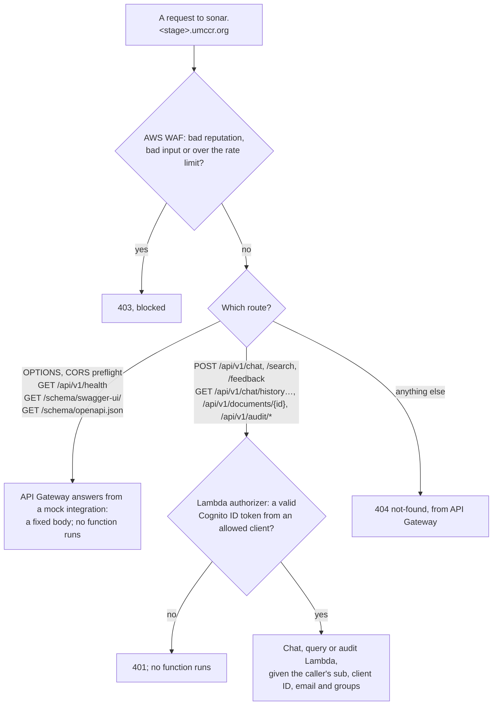
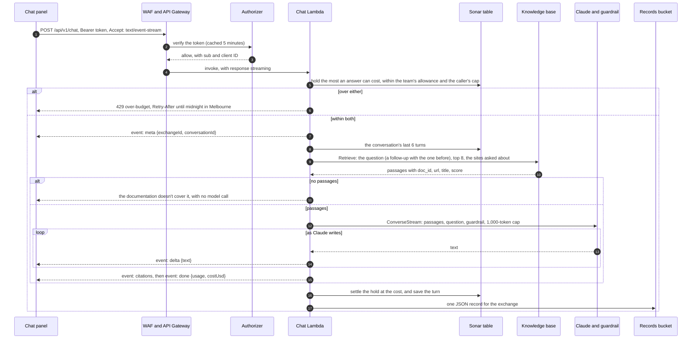
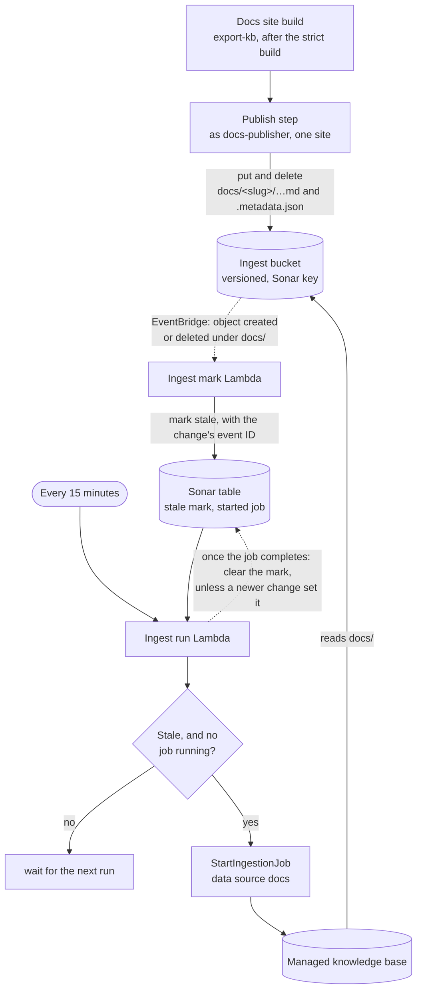
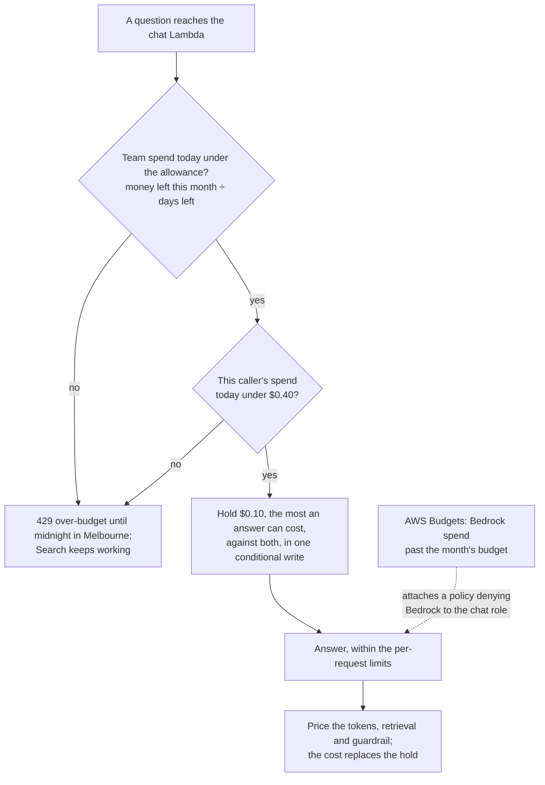
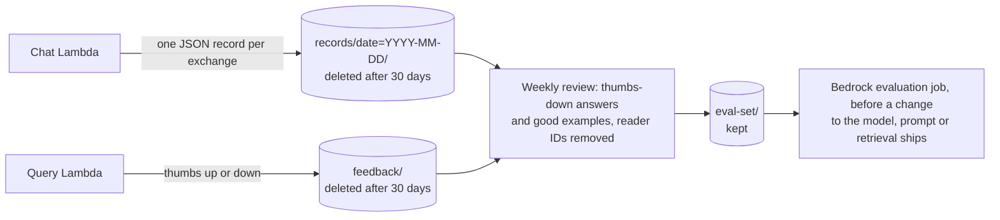
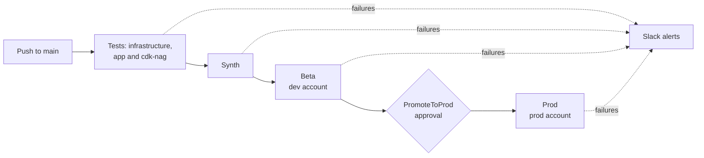

# OrcaSonar design

The decisions behind OrcaSonar and the reasons for them, with its diagrams and costs. Designed on 2026-10-09, with
prices and AWS details checked on 2026-10-08 and 2026-10-09. What is deployed is in [architecture.md](architecture.md)
and the API in [api.md](api.md).

Related, in `umccr/docs-platform`: the
[docs.umccr.org platform design](https://github.com/umccr/docs-platform/blob/main/docs/design/docs.umccr.org%20Platform%20Design.md)
and [ADR-0007, chat through OrcaSonar](https://github.com/umccr/docs-platform/blob/main/docs/design/adr/0007-chat-through-orcasonar.md).

## Decisions

| Topic          | Decision, and why                                                                                                                                                                                                                                          |
| -------------- | ---------------------------------------------------------------------------------------------------------------------------------------------------------------------------------------------------------------------------------------------------------- |
| Repository     | `umccr/orcasonar`, with two pipelines, one per stack.                                                                                                                                                                                                      |
| Address        | `sonar.<stage>.umccr.org`; `sonar.umccr.org` can follow if a page for people ever lives there.                                                                                                                                                             |
| API            | A regional API Gateway REST API, because the HTTP APIs OrcaBus services use cannot stream and stop at 30 seconds. Versioned under `/api/v1`, so `/api/v2` can sit beside it, and every error has one shape, API Gateway's own included ([api.md](api.md)). |
| Callers        | Cognito ID tokens, the way the portal calls OrcaBus, from named clients only: `docs-app`, OrcaUI's and, in beta, `localhost`. Not OrcaBus's whole list, which includes a client for machine tokens: machine callers wait for caps of their own.            |
| API docs       | Swagger UI and the contract served on each stage, as the OrcaBus services serve theirs.                                                                                                                                                                    |
| Sources        | UMCCR documentation only. Databases and APIs for real data come later, each as its own data source with its own access rules.                                                                                                                              |
| Knowledge base | A Bedrock managed knowledge base, serverless and pay per use, in its default configuration: managed embeddings, hybrid search and the managed reranker.                                                                                                    |
| Model          | Claude Sonnet 5 through the Australian cross-Region profile; Haiku 4.5 is allowed too, if its answers are good enough.                                                                                                                                     |
| `doc_id`       | `<slug>:<path>`, such as `platform:onboarding`, so citations, `/documents/{id}` and docs links agree.                                                                                                                                                      |

## The name

Sonar sends a signal down and reads back the shape of what lies below; retrieval does the same with a question. The
name follows the house pattern of Orca plus what the thing is, as in orcabus, orcahouse, orcavault and orcaglue.
"Sonar" alone is SonarQube, SonarCloud and Perplexity's Sonar API, so names use `orcasonar` in full. Also considered:
OrcaEcho (Amazon Echo, in an AWS-heavy organisation), OrcaLore (sounds less like search), OrcaFathom (Fathom, the AI
notetaker) and Orcasound, an existing orca hydrophone project.

## At a glance

Callers reach OrcaSonar only through the API, and only the docs site pipeline writes into it.
[architecture.md](architecture.md#components) describes each part.

## What a request can reach

The API is internet-facing because readers' browsers call it. What keeps it safe is that a request without a valid
token runs no code of ours: WAF filters first, API Gateway answers the open routes from fixed responses, and
everything else needs the authorizer's approval before a function runs.

`/health` was first served by the query Lambda without a token, and Security Hub flagged it: a function that reads
the knowledge base and both buckets was reachable without authorisation. API Gateway now answers `/health` itself
with `{"status": "ok", "version": "<commit>", "stage"}`, fixed at deploy time, and serves the API docs the same way.
The stack test `reaches a function only through the authorizer` fails if an open method integrates a Lambda.

The open routes give nothing away: they touch no function and no Bedrock, so they cannot run up cost, and the
contract is not secret. The authorizer's answer is cached five minutes per token, and its policy allows every route
of the stage, so a token valid for one route is valid for all.

## One question, end to end

The answer streams as the guardrail releases it, and the citations follow. Search stops after the retrieval.

## Ingestion

OrcaSonar reads neither GitHub nor docs.umccr.org: each site's publish uploads its pages to the ingest bucket, and
OrcaSonar indexes whatever is there. Ingestion jobs on one data source cannot overlap, and many sites can publish at
once, so a scheduled check starts one job at a time rather than one per publish. A push is usually searchable within
about 20 minutes. [architecture.md](architecture.md#ingestion) has the mechanism and the metadata format.

## Keeping the data on our side

The data stays inside AWS in Australia, under our own key. One nuance: the managed knowledge base keeps the index in
AWS-managed storage, encrypted with our key, rather than in a resource in our account.
[architecture.md](architecture.md#data-and-privacy) lists where each kind of data lives.

Making it enforceable rather than a default:

1. **No data kept by Bedrock.** Set the account's Bedrock data-retention mode to `none` in ap-southeast-2, with an SCP
   that stops anyone changing it, so models that require retention refuse to run. It is `inherit` in dev: an
   organisation administrator's decision.
2. **Only the models we chose.** The chat role may stream only from the `au.` profiles for Sonnet 5 and Haiku 4.5, and
   the models behind them in Sydney and Melbourne.
3. **No outside sources.** Only the ingest bucket feeds the knowledge base, and nothing outside AWS is called.
4. **No anonymous access.** Every route that reaches a function needs a token. A WAF allowlist of university and VPN
   ranges is the middle option before a private API, though it blocks readers at home without the VPN.
5. **Private network paths, optional.** VPC endpoints for `bedrock-runtime` and `bedrock-agent-runtime` would cost
   about $35 to $40 a month across two availability zones, nearly doubling the budget, so they wait for a security
   review that asks.
6. **Assessed for Australian government use.** Bedrock is assessed at IRAP PROTECTED, excluding Bedrock Marketplace,
   and AgentCore, which runs managed knowledge bases, joined the 2026 assessment. The report is in AWS Artifact.

If "on our side" must mean storage in our own account, use a self-managed knowledge base with S3 Vectors and an
embedding model run in Sydney. That gives up the managed reranker and hybrid search for placement we can prove.

## Cost, and keeping it under $50 a month

Model tokens are almost the whole bill. After about $2 a month of fixed costs, $48 is left for questions: about $1.60
a day.

| Item                                              | Price                                                                                  |
| ------------------------------------------------- | -------------------------------------------------------------------------------------- |
| Claude Sonnet 5, `au.` profile                    | $2.20 per million input tokens, $11 per million output tokens                          |
| Claude Haiku 4.5, `au.` profile                   | $1.10 per million input tokens, $5.50 per million output tokens                        |
| Knowledge base                                    | $0.001 per retrieval; storage $5 per GB-month (well under $1 for the docs)             |
| Guardrail                                         | $0.10 to $0.15 per 1,000 text units, per policy; a text unit is up to 1,000 characters |
| Lambda, API Gateway, WAF, DynamoDB, records, logs | a few dollars a month together; WAF's web ACL and rules are most of it                 |

| Use                                           | Tokens assumed       | Cost each    | Within $48 a month       |
| --------------------------------------------- | -------------------- | ------------ | ------------------------ |
| Search: ranked passages and links, no model   | none                 | $0.001       | unlimited in practice    |
| Ask, with Sonnet 5                            | 5,000 in, 400 out    | about $0.019 | 2,500 a month, 84 a day  |
| Ask, with Haiku 4.5                           | 5,000 in, 400 out    | about $0.011 | 4,250 a month, 140 a day |
| Plan (later), Sonnet 5 with agentic retrieval | 12,000 in, 2,000 out | about $0.06  | 790 a month, 26 a day    |

Dollars, not questions, because answers vary in cost and Bedrock reports each one's tokens. Each day's allowance is
what is left of the month over the days left, so unused budget carries forward. A caller's cap of $0.40, about 20
answers, means it takes four readers at their cap to use up a day. The per-request limits keep any answer under about
8 cents, so the $0.10 hold covers it, and holding first stops answers asked at once from all passing a check that each
would pass alone. AWS Budgets is only a backstop, since its data updates a few times a day. Search, at a tenth of a
cent, keeps working when the allowance is spent; Haiku 4.5 would stretch the budget by about 70%.
[architecture.md](architecture.md#budget) has the mechanism.

## Questions and answers: 30 days, for evaluation

Examples worth keeping longer are copied, without reader IDs, into an evaluation set that tests changes before they
ship. The chat panel tells readers that questions are kept 30 days to improve answers.

Only the platform team should read the records; today that rests on who has access to the account, not on a bucket
policy.

The audit log keeps the same exchanges, failed ones too, with the reader's email, so portal administrators can review
them through the API without account access. Who may is one setting, `AUDIT_GROUP`, so a group of OrcaSonar's own can
replace `admin`. The email stays out of the logs and the records, and readers must be told about it before prod
([open items](project.md#open-items)).

Bedrock's model invocation logging is a setting for the whole account and Region, and would capture every Bedrock
call with full prompts. OrcaSonar writes its own records instead: leave invocation logging off unless OrcaSonar is the
account's only Bedrock user.

## Deploying

Each stack has its own pipeline, so the data and the API deploy apart.

| Stack                     | Holds                                                                                                       | Why it is separate                                   |
| ------------------------- | ----------------------------------------------------------------------------------------------------------- | ---------------------------------------------------- |
| `OrcaSonarStatefulStack`  | the Sonar KMS key, ingest and records buckets, Sonar table, knowledge base and its data source, guardrail   | data and the index survive API changes; kept in prod |
| `OrcaSonarStatelessStack` | the API and its domain, WAF, the functions, the API docs, ingestion scheduling, alarms, the budget backstop | changes often and is safe to replace                 |

[deploy.md](deploy.md) has the steps.

## Sources

- API: [API Gateway response streaming for REST APIs](https://aws.amazon.com/about-aws/whats-new/2025/11/api-gateway-response-streaming-rest-apis);
  [limits and caveats](https://aws.amazon.com/blogs/compute/building-responsive-apis-with-amazon-api-gateway-response-streaming/);
  [mapping template quotas](https://docs.aws.amazon.com/apigateway/latest/developerguide/api-gateway-execution-service-limits-table.html);
  `orca-ui-v2/src/api/auth-middleware.ts`
- Knowledge base: [managed knowledge base](https://aws.amazon.com/about-aws/whats-new/2026/06/amazon-bedrock-managed-knowledge-base/);
  [creating one: KMS key and embedding options](https://docs.aws.amazon.com/bedrock/latest/userguide/kb-managed-create.html);
  [S3 connector](https://docs.aws.amazon.com/bedrock/latest/userguide/kb-managed-ds-s3.html);
  [metadata files](https://docs.aws.amazon.com/bedrock/latest/userguide/kb-metadata.html);
  [pricing](https://aws.amazon.com/blogs/machine-learning/build-enterprise-search-for-agents-with-amazon-bedrock-managed-knowledge-base/)
- Data protection: [Bedrock data protection](https://docs.aws.amazon.com/bedrock/latest/userguide/data-protection.html);
  [abuse detection](https://docs.aws.amazon.com/bedrock/latest/userguide/abuse-detection.html);
  [data retention modes](https://docs.aws.amazon.com/bedrock/latest/userguide/data-retention.html);
  [VPC endpoints](https://docs.aws.amazon.com/bedrock/latest/userguide/vpc-interface-endpoints.html);
  [IRAP services in scope](https://aws.amazon.com/compliance/services-in-scope/IRAP/)
- Models and prices: [Claude Sonnet 5 model card](https://docs.aws.amazon.com/bedrock/latest/userguide/model-card-anthropic-claude-sonnet-5.html);
  [regional pricing and Haiku 4.5](https://www.cloudzero.com/blog/amazon-bedrock-pricing/);
  [Guardrails pricing](https://cloudchipr.com/blog/amazon-bedrock-pricing)
- Agents, later: [AgentCore Gateway: OpenAPI to MCP](https://aws.amazon.com/blogs/machine-learning/introducing-amazon-bedrock-agentcore-gateway-transforming-enterprise-ai-agent-tool-development/).
  Name: [Orcasound](https://www.orcasound.net/)
