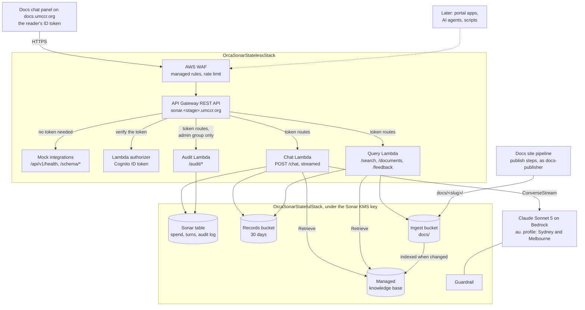
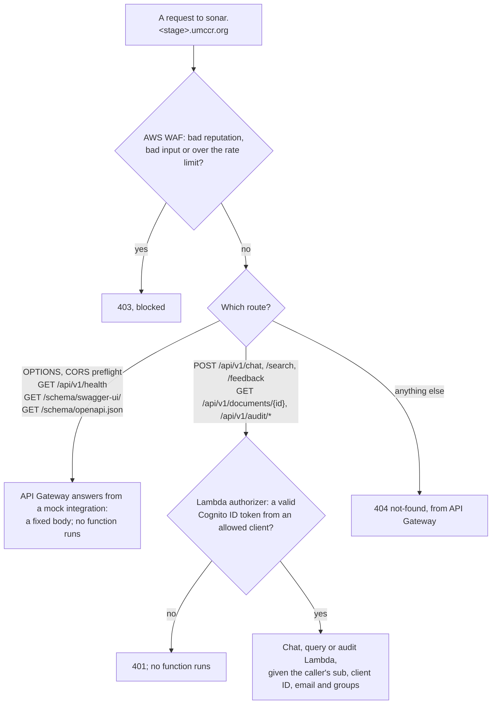
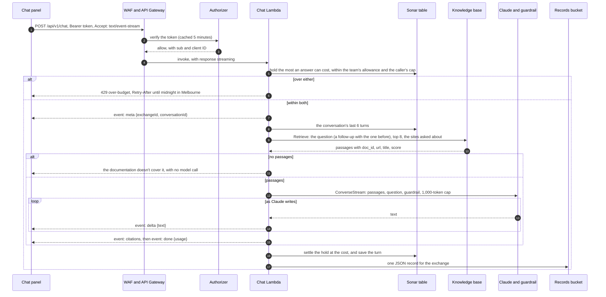
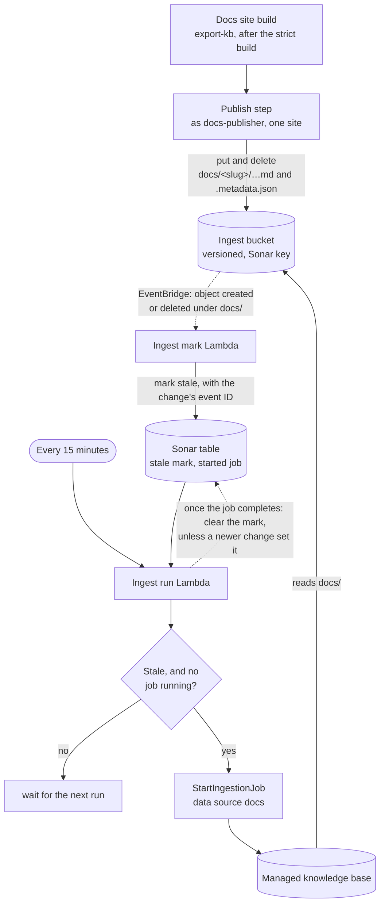
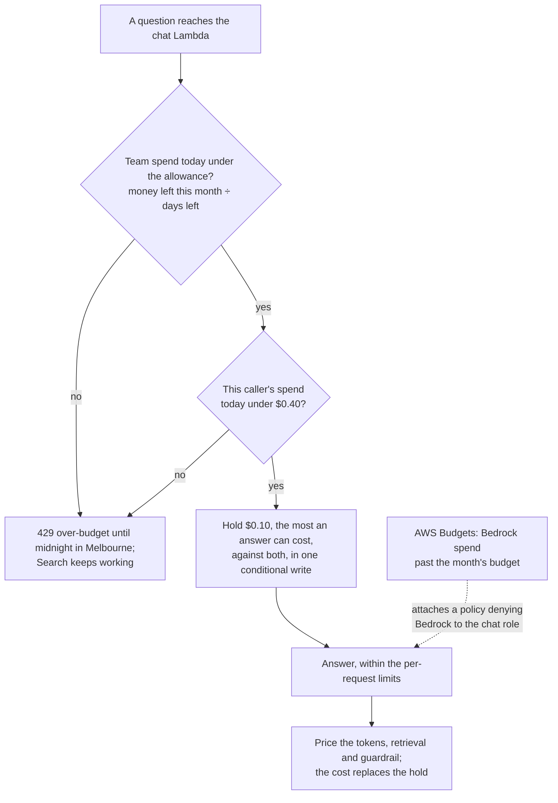
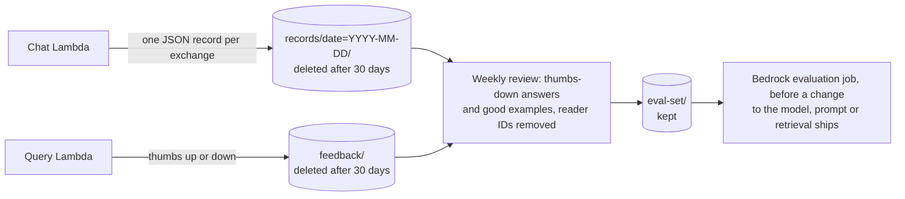
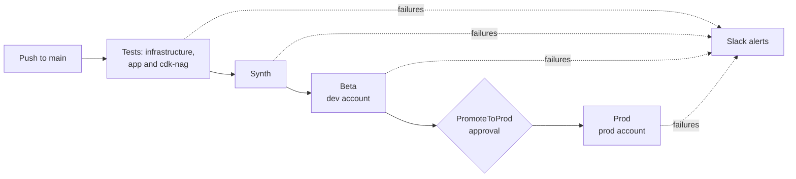

# OrcaSonar design

OrcaBus runs the pipelines and workflows, OrcaHouse holds the data, and OrcaSonar finds the knowledge and
documentation behind them. A question goes down; passages and an answer come back, with links to where they came
from. The first release answers questions about UMCCR documentation for the chat panel on docs.umccr.org, through one
small API.

Designed on 9 October 2026, built in October 2026 and deployed to dev. Prices and AWS details were checked on 8 and 9
October 2026. This page is the design and the reasons for it; [architecture.md](architecture.md) describes what is
deployed in detail, [api.md](api.md) the API, [deploy.md](deploy.md) how to deploy it and [runbook.md](runbook.md)
how to operate it.

Related, in `umccr/docs-platform`: the
[docs.umccr.org platform design](https://github.com/umccr/docs-platform/blob/main/docs/design/docs.umccr.org%20Platform%20Design.md)
and [ADR-0007, chat through OrcaSonar](https://github.com/umccr/docs-platform/blob/main/docs/design/adr/0007-chat-through-orcasonar.md).

## Decisions

| Topic                 | Decision                                                                                                                                                                                          | Status                                        |
| --------------------- | ------------------------------------------------------------------------------------------------------------------------------------------------------------------------------------------------- | --------------------------------------------- |
| Repository            | `umccr/orcasonar`, with its own two pipelines, one per stack.                                                                                                                                     | built                                         |
| Address               | `sonar.<stage>.umccr.org`: `sonar.dev.umccr.org`, `sonar.stg.umccr.org`, `sonar.prod.umccr.org`. `sonar.umccr.org` can follow if a page for people ever lives there.                              | built in dev                                  |
| Streaming             | `/chat` streams from the first release, through an API Gateway REST API with response streaming.                                                                                                  | built                                         |
| Callers in release 1  | The docs chat panel only: ID tokens from the `docs-app` Cognito client.                                                                                                                           | built                                         |
| Open routes           | API Gateway answers every route that needs no token itself, from mock integrations. Every Lambda integration is behind the authorizer. See [what a request can reach](#what-a-request-can-reach). | built, after a Security Hub finding (October) |
| API docs              | Swagger UI at `/schema/swagger-ui/` and the contract at `/schema/openapi.json`, on each stage, as the OrcaBus services serve theirs.                                                              | built                                         |
| Sources in release 1  | UMCCR documentation only, from docs.umccr.org. Databases and APIs for real data come later.                                                                                                       | built                                         |
| Knowledge base        | Bedrock managed knowledge base, serverless and pay as you go, with the default minimal configuration.                                                                                             | built                                         |
| Questions and answers | Kept 30 days in a bucket, for evaluation.                                                                                                                                                         | built                                         |
| Audit log             | Who asked what and the answer, with the reader's email, kept 30 days in the Sonar table. `/api/v1/audit/*` lists it, and usage per reader, for the data-portal `admin` group only.                | built, not yet deployed                       |
| Name                  | OrcaSonar; `orcasonar` for the repository, stacks and SSM names.                                                                                                                                  | decided                                       |
| Model                 | Claude Sonnet 5 through the Australian cross-Region profile; Haiku 4.5 is allowed too, if its answers are good enough.                                                                            | built; blocked in dev by the region policy    |
| Budget                | $50 a month in prod and $10 in dev and stg, enforced by OrcaSonar itself, with an AWS Budgets backstop.                                                                                           | built                                         |

## The name

Sonar sends out a signal and reads back the shape of what lies below the surface. Retrieval does the same: a query
goes down, and the documents that match come back. The name also follows the house pattern of Orca plus what the
thing is, as in orcabus, orcahouse, orcavault and orcaglue. "Sonar" on its own is SonarQube and SonarCloud, which no
UMCCR repository uses, and Perplexity's Sonar API, so the repository, stacks and parameters use `orcasonar` in full.

| Name                   | The idea                                             | Against it                                                                |
| ---------------------- | ---------------------------------------------------- | ------------------------------------------------------------------------- |
| **OrcaSonar** (chosen) | Send a question down; read back what lies beneath    | SonarQube, SonarCloud and Perplexity's Sonar API exist in the wider world |
| OrcaEcho               | Orcas echolocate; the echo is the answer coming back | Amazon Echo, in an AWS-heavy organisation                                 |
| OrcaLore               | Orca pods pass knowledge down the generations        | sounds less like search, and slightly like a game                         |
| OrcaFathom             | To fathom is to understand, and to sound the depth   | Fathom, the AI notetaker, and Fathom Analytics                            |
| Orcasound              |                                                      | avoid: an existing open-source orca hydrophone project                    |

## At a glance

Two stacks in each stage account, each deployed by its own pipeline. Callers reach OrcaSonar only through the API,
and the only thing that writes into it is the docs site pipeline. Everything it stores, the index included, is
encrypted with one Sonar KMS key. Ingestion and the budget have their own diagrams below.



Release 1 has one caller; the later ones are drawn to make room for them, not because they are planned for a date.

| Part                   | What it does, and why                                                                                                                                                                                                                                                                                                                                        |
| ---------------------- | ------------------------------------------------------------------------------------------------------------------------------------------------------------------------------------------------------------------------------------------------------------------------------------------------------------------------------------------------------------ |
| AWS WAF                | AWS managed rule groups and a rate limit per address. The common rules that look for paths, HTML and addresses in a request body only count, since questions about `../` links, HTML tags and internal URLs trip them. An allowlist of university and VPN ranges can be added if a review asks for one; it would also block readers at home without the VPN. |
| API Gateway REST API   | Regional, with the custom domain on the certificate and hosted zone each stage already has. A REST API rather than the HTTP API OrcaBus services use, because HTTP APIs can't stream and stop at 30 seconds. Answers the open routes itself.                                                                                                                 |
| Lambda authorizer      | Verifies the Cognito ID token with `aws-jwt-verify`: the `data-portal-<stage>` pool, token use `id`, and an allowed client. Release 1 allows only `docs-app`; the `docs-app` client never goes on the OrcaBus API list.                                                                                                                                      |
| Chat Lambda            | Holds the most an answer can cost against the budget, retrieves, builds the prompt, calls Claude with the guardrail, streams server-sent events, then settles the hold at the answer's cost and records the exchange. Logs hold the reader's `sub` and the outcome, never the question.                                                                      |
| Query Lambda           | `/search`, `/documents/{id}` and `/feedback`, answered as ordinary JSON.                                                                                                                                                                                                                                                                                     |
| Audit Lambda           | `/audit/exchanges`, `/audit/conversations/{id}` and `/audit/usage`: who asked what, the answers, and usage per reader. Only members of the data-portal pool's `admin` group get past it; it reads only the table, and logs who read what without logging what it returned.                                                                                   |
| Sonar table            | One DynamoDB table: spend per reader per day, team spend per month, conversation turns and the audit log (both expire after 30 days) and the ingestion state. Callers are keyed by `sub` for people and by client ID for machine callers.                                                                                                                    |
| Ingest bucket          | The only input to the knowledge base. Only the docs pipeline's `docs-publisher` role writes, and only under `docs/`. Versioned, so an accidental delete is recoverable.                                                                                                                                                                                      |
| Managed knowledge base | One per stage: managed embeddings, hybrid search and the managed reranker. Each passage keeps its page's `doc_id`, `url`, `site` and `title`, so sources become links and a question can stay within one site.                                                                                                                                               |
| Guardrail              | Applied to every model call: denied topics (medical advice about a person, personal data about patients), masking of personal data in answers, and a grounding check that flags answers the passages don't support.                                                                                                                                          |
| Claude Sonnet 5        | Called through the `au.` inference profile, which runs only in Sydney and Melbourne. Haiku 4.5 is the cheaper option if its answers are good enough.                                                                                                                                                                                                         |

## What a request can reach

The API has to be reachable from readers' browsers, so it is internet-facing. What keeps it safe is that a request
without a valid token runs no code of ours: WAF filters first, API Gateway answers the open routes from fixed
responses, and everything else needs the authorizer's approval before a function runs.



`/health` used to be served by the query Lambda without a token. Security Hub flagged that as potential unauthorised
access: a function with access to the knowledge base, the ingest bucket and the records bucket was reachable through an
API Gateway method without authorisation. API Gateway now answers `/health` itself with
`{"status": "ok", "version": "<commit>", "stage"}`, fixed at deploy time, and the same mechanism serves the API docs.
A stack test, `reaches a function only through the authorizer`, fails if any open method integrates a Lambda.

The open routes give up nothing: `/health` says the domain, WAF and API Gateway are up but never touches a function
or Bedrock, so it can't run up cost, and the contract is not a secret. The authorizer's answer is cached for five
minutes per token, and its policy allows every route of the stage, so a token valid for one route is valid for all.

## The API

Version 1 lives under `https://sonar.<stage>.umccr.org/api/v1`, and each stage documents itself at
`/schema/swagger-ui/`. Every endpoint but `/health` needs a Cognito ID token in `Authorization: Bearer`, the way the
portal calls OrcaBus. Responses are JSON, except `/chat`, which streams when asked to. Errors share one shape:
`{"error": {"code", "message", "retryAfter"?}}`. Requests, the stream, every error code and the limits are in
[api.md](api.md).

| Method and path                        | Token            | Request                                          | Response                                                                                                                                                     | Status |
| -------------------------------------- | ---------------- | ------------------------------------------------ | ------------------------------------------------------------------------------------------------------------------------------------------------------------ | ------ |
| `POST /api/v1/chat`                    | yes              | `{query, conversationId?, sites?, mode?}`        | with `Accept: text/event-stream`, events `meta`, `delta`…, `citations`, `done`; otherwise one JSON object with the answer, citations, `exchangeId` and usage | built  |
| `POST /api/v1/search`                  | yes              | `{query, topK?, sites?}`, `topK` up to 20        | `{results: [{id, title, url, site, snippet, score}]}`, with no model call                                                                                    | built  |
| `GET /api/v1/documents/{id}`           | yes              | a `doc_id`, URL-encoded                          | `{id, title, url, site, updated, markdown}`                                                                                                                  | built  |
| `POST /api/v1/feedback`                | yes              | `{exchangeId, rating, comment?}`                 | `204`                                                                                                                                                        | built  |
| `GET /api/v1/audit/exchanges`          | yes, admin group | `from?, to?, caller?, outcome?, limit?, cursor?` | the audit log, newest first: who asked, the question, the start of the answer, outcome and cost                                                              | built  |
| `GET /api/v1/audit/conversations/{id}` | yes, admin group | a `conversationId`                               | the whole conversation with full answers and sources                                                                                                         | built  |
| `GET /api/v1/audit/usage`              | yes, admin group | `from?, to?`                                     | questions, outcomes, tokens and cost per reader                                                                                                              | built  |
| `GET /api/v1/health`                   | no               |                                                  | `{status, version, stage}`, from API Gateway                                                                                                                 | built  |
| `GET /schema/swagger-ui/`              | no               |                                                  | Swagger UI for the contract                                                                                                                                  | built  |
| `GET /schema/openapi.json`             | no               |                                                  | the contract, for clients and for AgentCore Gateway to turn into MCP tools                                                                                   | built  |
| `GET /api/v1/sources`                  | yes              |                                                  | what is indexed, per source: documents and the last sync                                                                                                     | later  |
| `GET /api/v1/usage`                    | yes              |                                                  | the caller's allowance left today                                                                                                                            | later  |

`doc_id` is a site's slug and a page's path, such as `platform:onboarding`, so citations, `/documents/{id}` and docs
links all agree. `mode` is reserved for a later Plan mode; release 1 answers in Ask mode only.

## One question, end to end

The first words reach the reader as soon as Claude writes them; the citations follow the answer. Search stops after
the retrieval and returns the passages as JSON, from the query Lambda.



## Ingestion

OrcaSonar doesn't read GitHub or docs.umccr.org. The docs site pipeline hands it documents: each publish uploads the
site's pages as processed Markdown, each with a metadata file, and deletes the ones no longer published. OrcaSonar
indexes whatever is in the bucket.

Ingestion jobs on one data source can't overlap, and many sites can publish at once, so a scheduled check starts at
most one job at a time instead of each publish starting its own. The index stays marked stale until a job completes:
a job that fails raises an alarm, and the next check starts another. A push is usually searchable within about 20
minutes.



The metadata file for `docs/platform/onboarding.md`, written by the docs toolkit's `export-kb`:

```json
{
  "metadataAttributes": {
    "doc_id": "platform:onboarding",
    "site": "platform",
    "title": "Onboarding a site",
    "url": "https://docs.umccr.org/platform/onboarding/",
    "commit": "3f2c9e1",
    "updated": "2026-10-09"
  }
}
```

Each metadata file sits beside its page, as `<page>.md.metadata.json`, which is where the managed S3 connector looks
when the data source names no metadata prefix. Retrieval filters on `site` when a question names sites. Later
sources, such as OrcaBus API docs or OrcaHouse schemas, each get their own data source and their own access rules
rather than sharing `docs`.

## Keeping the data on our side

The data stays inside AWS in Australia, under our own key, with no public or anonymous access to anything that holds
it. One nuance: the managed knowledge base keeps the index in AWS-managed storage, encrypted with our key, rather than
in a resource in our account.

| Data                            | Where it lives                         | Control                                                                                                                                                                |
| ------------------------------- | -------------------------------------- | ---------------------------------------------------------------------------------------------------------------------------------------------------------------------- |
| Source documents                | the ingest bucket, Sydney              | public access blocked; Sonar KMS key; only `docs-publisher` writes, only OrcaSonar reads                                                                               |
| The index: chunks and vectors   | Bedrock's managed vector store, Sydney | encrypted with the Sonar KMS key, chosen when the knowledge base is created; AWS-managed storage, not a resource in our account                                        |
| Embedding and reranking         | service-managed models                 | AWS doesn't say where they run: ask before indexing anything sensitive. Bringing Titan Text Embeddings V2 instead switches off the managed reranker                    |
| Questions and answers in flight | Claude, `au.` profile                  | processed in Sydney and Melbourne only. Bedrock keeps no prompts or answers and doesn't train on them; model providers have no access to the accounts where models run |
| Our records                     | Sonar table, records bucket, logs      | our account and our key; deleted after 30 days; logs never hold the question or the email; the audit log, with emails, is read only by the audit group                 |

Making it enforceable rather than a default:

1. **No data kept by Bedrock.** Set the account's Bedrock data-retention mode to `none` in ap-southeast-2, and add an
   SCP that stops anyone changing it. Models that require retention then refuse to run. It is `inherit` in dev
   today: an organisation administrator's decision.
2. **Only the models we chose.** The chat role may stream only from the `au.` profiles for Sonnet 5 and Haiku 4.5,
   and the models behind them in Sydney and Melbourne.
3. **No outside sources.** Only the ingest bucket feeds the knowledge base: no web crawler, no external connectors.
   OrcaSonar calls nothing outside AWS.
4. **No anonymous access to data.** Every route that reaches a function needs a token, behind WAF and throttling
   ([what a request can reach](#what-a-request-can-reach)). A truly private API would need a VPN for every reader; a
   WAF allowlist of university and VPN ranges is the middle option.
5. **Private network paths, optional.** VPC endpoints for `bedrock-runtime` and `bedrock-agent-runtime` keep
   Lambda-to-Bedrock traffic off public endpoints. They cost about $35 to $40 a month across two availability zones,
   nearly doubling the budget, so add them only if a security review asks.
6. **Assessed for Australian government use.** Bedrock is assessed at IRAP PROTECTED, excluding Bedrock Marketplace,
   and AgentCore, which runs managed knowledge bases, was added in the 2026 assessment. The report is in AWS
   Artifact.

If "on our side" must mean storage in our own account, use a self-managed knowledge base with S3 Vectors in our
account and an embedding model run in Sydney. That gives up the managed reranker and hybrid search in exchange for
placement we can prove.

## Cost, and keeping it under $50 a month

Model tokens are almost the whole bill. After about $2 a month of fixed costs, $48 is left for questions: about
$1.60 a day.

| Item                                              | Price                                                                                  |
| ------------------------------------------------- | -------------------------------------------------------------------------------------- |
| Claude Sonnet 5, `au.` profile                    | $2.20 per million input tokens, $11 per million output tokens                          |
| Claude Haiku 4.5, `au.` profile                   | $1.10 per million input tokens, $5.50 per million output tokens                        |
| Knowledge base                                    | $0.001 per retrieval; storage $5 per GB-month (well under $1 for the docs)             |
| Guardrail                                         | $0.10 to $0.15 per 1,000 text units, per policy; a text unit is up to 1,000 characters |
| Lambda, API Gateway, WAF, DynamoDB, records, logs | a few dollars a month together; WAF's web ACL and rules are most of it                 |

| Use                                           | Tokens assumed       | Cost each    | Within $48 a month       |
| --------------------------------------------- | -------------------- | ------------ | ------------------------ |
| Search: ranked passages and links, no model   | none                 | $0.001       | unlimited in practice    |
| Ask, with Sonnet 5                            | 5,000 in, 400 out    | about $0.019 | 2,500 a month, 84 a day  |
| Ask, with Haiku 4.5                           | 5,000 in, 400 out    | about $0.011 | 4,250 a month, 140 a day |
| Plan (later), Sonnet 5 with agentic retrieval | 12,000 in, 2,000 out | about $0.06  | 790 a month, 26 a day    |



1. **Count dollars, not questions.** Bedrock returns the tokens used by every answer, so the chat Lambda prices each
   exchange and adds it to the Sonar table. Before the answer, it holds more than any answer can cost against the
   caller's and the team's spend, in one conditional write, so answers asked at once can't all pass a check that each
   would pass alone; the answer's cost then replaces the hold.
2. **A team allowance per day**: the money left this month divided by the days left. It starts near $1.60 and unused
   budget carries forward. When it runs out, Ask returns `429 over-budget` until tomorrow; Search keeps working, as
   it costs a tenth of a cent.
3. **A cap per caller of $0.40 a day**, about 20 answers. It takes four readers at their cap to use up a day, so one
   person can't block everyone else. Machine callers, later, get their own caps by client ID.
4. **Limits per request**: 2,000 characters of question, six turns of history, eight passages and 1,000 output
   tokens keep the most expensive single answer under about 8 cents.
5. **A backstop**: an AWS Budgets action that notifies at 80% and, at 100%, attaches a policy denying Bedrock to the
   chat role. Budgets data updates only a few times a day, so the table is the real control.

Answering with Haiku 4.5 instead stretches the same budget by about 70%.

## Questions and answers: 30 days, for evaluation

Every exchange is kept for 30 days in a private bucket and then deleted. Examples worth keeping longer are copied,
without reader identifiers, into an evaluation set that measures answer quality before anything changes. The docs
chat panel tells readers that questions are kept for 30 days to improve answers.



A record holds the question, the answer, the cited documents and scores, the model, tokens, cost, response time,
whether the guardrail intervened, and the reader's Cognito `sub`. Only the platform team should read the bucket;
today that rests on who has access to the account, not on a bucket policy.

The same exchanges, and the failed ones, also go into an audit log in the Sonar table, with the reader's email from
their ID token, and expire after the same 30 days. The audit API lists them, and usage per reader, to members of the
data-portal pool's `admin` group, so portal administrators can read everyone's questions there without account
access. The group is one setting (`AUDIT_GROUP`), so a group of OrcaSonar's own can replace it. Each read is logged
with who made it. The email stays out of the logs and the records bucket, so the weekly review and the evaluation
set are unchanged.

Before readers use the audit log in prod, the docs chat panel's notice should say so: that questions are kept for 30
days to improve answers, and that UMCCR administrators can review them with the reader's email.

Bedrock's model invocation logging is a setting for the whole account and Region and would capture every Bedrock call
with full prompts. OrcaSonar writes its own records instead; leave invocation logging off unless OrcaSonar is the
account's only Bedrock user.

## Deploying

Two pipelines in the toolchain account, `UMCCR-OrcaSonarStateful` and `UMCCR-OrcaSonarStateless`, built by
`infrastructure/toolchain/deployment-pipeline.ts`: the OrcaBus pipeline construct, adapted so that nothing is named
for OrcaBus. The stateless stack reads the stateful stack's resources from SSM, so in every account the stateful
stack deploys first.



| Stack                     | Holds                                                                                                                                                       | Why it is separate                                   |
| ------------------------- | ----------------------------------------------------------------------------------------------------------------------------------------------------------- | ---------------------------------------------------- |
| `OrcaSonarStatefulStack`  | Sonar KMS key, ingest bucket and its policy for `docs-publisher`, records bucket, Sonar table, managed knowledge base and its `docs` data source, guardrail | data and the index survive API changes; kept in prod |
| `OrcaSonarStatelessStack` | REST API and custom domain, WAF, authorizer, chat, query and audit Lambdas, the API docs, ingestion scheduling, alarms, the AWS Budgets backstop            | changes often and is safe to replace                 |

What it reads and writes in SSM:

| SSM parameter                                      | Direction | Used for                                                 |
| -------------------------------------------------- | --------- | -------------------------------------------------------- |
| `/umccr/certificate_arn`                           | read      | the API's custom domain                                  |
| `/hosted_zone/umccr/id`, `/hosted_zone/umccr/name` | read      | the `sonar` alias record                                 |
| `/data_portal/client/cog_user_pool_id`             | read      | the authorizer's user pool                               |
| `/cognito/docs-app/app-client-id`                  | read      | the authorizer's allowed client                          |
| `/orcasonar/ingest-bucket-name`                    | written   | the docs publish steps find the bucket                   |
| `/orcasonar/api-url`                               | written   | the docs theme's `env.js`                                |
| `/orcasonar/*`, the rest                           | written   | the stateless stack finds the stateful stack's resources |

Watching it: alarms on failed answers and on writes that the chat Lambda logs rather than throws, on the API's 5XX
responses, on Lambda crashes and timeouts, and on ingestion that could not be marked, scheduled or completed, beside
the budget's 80% warning. Each tells one alerts topic as it fires and as it clears, and a team address or an AWS
Chatbot channel subscribes to it. Still to build: a Synthetics canary. A canary on `/health` shows only that the
domain, WAF and API Gateway are up, so a deeper one waits for a machine client that can call `/chat`.

## Delivery

1. **Spike in dev.** A managed knowledge base on a dev ingest bucket, filled from a prototype of `export-kb`, tried
   with real questions. Done.
2. **Stateful stack.** Key, ingest bucket, knowledge base, table, records bucket and guardrail. Deployed to dev; the
   docs pipeline writes `docs/<slug>/` into it.
3. **Stateless stack and the docs panel.** The REST API with streaming, WAF, the authorizer, both Lambdas, the budget,
   alarms and the API docs. Deployed to dev, where the docs chat panel calls it and it answers (2026-10-15).
4. **Later**, each when someone needs it: portal apps as callers, a machine client and AgentCore Gateway for AI
   agents, `/sources` and `/usage`, a Plan mode, and the first real-data sources, OrcaHouse tables or OrcaBus APIs,
   each as its own data source or tool with its own access rules.

To confirm, with the details in [architecture.md](architecture.md#open-items):

1. Anthropic's model agreements in prod, which an account administrator accepts by hand: Claude Sonnet 5's was
   `NOT_AVAILABLE` there on 2026-10-21. dev's were accepted, and the organisation's region policy opened
   ap-southeast-4, on 2026-10-15.
2. The data-retention mode and its SCP, set by whoever administers the organisation's Bedrock settings.
3. Where the managed knowledge base's embedding and reranking models run.
4. Whether the budget backstop sees Claude's cost, which is billed through AWS Marketplace, and who subscribes to the
   alerts topic.
5. Whether a security review wants the WAF allowlist or the VPC endpoints.

## Sources

- API: [API Gateway response streaming for REST APIs](https://aws.amazon.com/about-aws/whats-new/2025/11/api-gateway-response-streaming-rest-apis);
  [limits and caveats](https://aws.amazon.com/blogs/compute/building-responsive-apis-with-amazon-api-gateway-response-streaming/);
  [mapping template quotas](https://docs.aws.amazon.com/apigateway/latest/developerguide/api-gateway-execution-service-limits-table.html);
  `orca-ui-v2/src/api/auth-middleware.ts`
- Knowledge base: [managed knowledge base](https://aws.amazon.com/about-aws/whats-new/2026/06/amazon-bedrock-managed-knowledge-base/);
  [creating one: KMS key and embedding options](https://docs.aws.amazon.com/bedrock/latest/userguide/kb-managed-create.html);
  [S3 connector](https://docs.aws.amazon.com/bedrock/latest/userguide/kb-managed-ds-s3.html);
  [metadata files](https://docs.aws.amazon.com/bedrock/latest/userguide/kb-metadata.html);
  [pricing](https://aws.amazon.com/blogs/machine-learning/build-enterprise-search-for-agents-with-amazon-bedrock-managed-knowledge-base/)
- Data protection: [Bedrock data protection](https://docs.aws.amazon.com/bedrock/latest/userguide/data-protection.html);
  [abuse detection](https://docs.aws.amazon.com/bedrock/latest/userguide/abuse-detection.html);
  [data retention modes](https://docs.aws.amazon.com/bedrock/latest/userguide/data-retention.html);
  [VPC endpoints](https://docs.aws.amazon.com/bedrock/latest/userguide/vpc-interface-endpoints.html);
  [IRAP services in scope](https://aws.amazon.com/compliance/services-in-scope/IRAP/)
- Models and prices: [Claude Sonnet 5 model card](https://docs.aws.amazon.com/bedrock/latest/userguide/model-card-anthropic-claude-sonnet-5.html);
  [regional pricing and Haiku 4.5](https://www.cloudzero.com/blog/amazon-bedrock-pricing/);
  [Guardrails pricing](https://cloudchipr.com/blog/amazon-bedrock-pricing)
- Agents, later: [AgentCore Gateway: OpenAPI to MCP](https://aws.amazon.com/blogs/machine-learning/introducing-amazon-bedrock-agentcore-gateway-transforming-enterprise-ai-agent-tool-development/).
  Name: [Orcasound](https://www.orcasound.net/)
